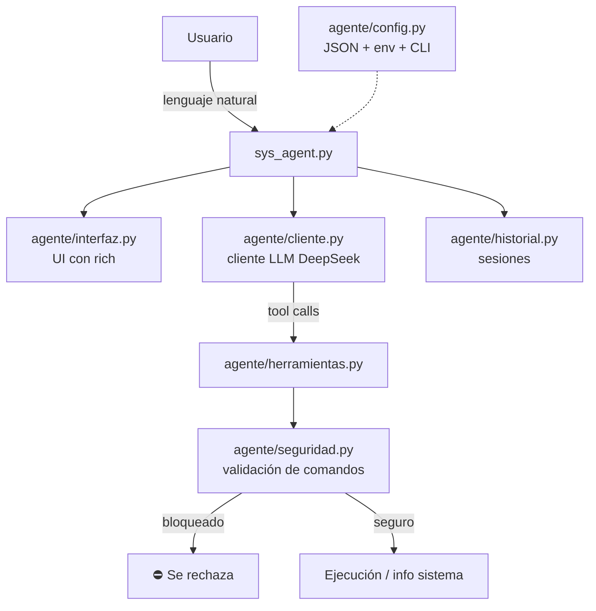

# 🤖 Agente DeepSeek — Administrador Autónomo de Linux

> **Agente en Python que administra sistemas Linux en lenguaje natural**, con un
> **diseño seguro por defecto**: clasifica cada acción, bloquea comandos
> destructivos y exige confirmación humana antes de aplicar cambios reales.


---

## 🔒 Seguridad primero (el punto clave)

Un agente que ejecuta comandos en tu sistema tiene que ser **seguro por diseño**.
Este proyecto lo aborda en serio:

- **Clasificación de acciones**: lectura/diagnóstico se ejecuta libremente;
  cualquier cambio real (`es_cambio=True`) **pide permiso al usuario** antes de ejecutarse.
- **Lista negra de comandos destructivos**: patrones como `rm -rf /`, `mkfs`,
  escritura directa a disco (`dd ... of=/dev/sd`), *fork bombs* o sobrescritura de
  `/etc/passwd` se bloquean automáticamente.
- **Detección de comandos encadenados**: `ls && rm -rf /` no engaña al validador —
  analiza cada parte del comando por separado.
- **Log de auditoría**: toda la actividad queda registrada para su revisión.

> El módulo de seguridad (`agente/seguridad.py`) es el corazón del proyecto y está
> cubierto por tests automatizados.

---

## ✨ Características

- 🧰 **Caja de herramientas**: ejecución de comandos con *timeouts*, lectura/escritura
  de archivos, búsqueda de paquetes (`dpkg`/`apt`) e información estructurada del sistema.
- 💾 **Historial persistente**: guarda y continúa sesiones anteriores (JSON).
- 🎨 **Interfaz de terminal** enriquecida con `rich` (spinners, paneles, tablas).
- ⚙️ **Configuración flexible**: JSON, variables de entorno y argumentos CLI.
- 🧪 **18 tests** + integración continua con GitHub Actions.

---

## 🏗️ Arquitectura



**Estructura:**

```
├── sys_agent.py            # Punto de entrada (CLI)
├── agente/
│   ├── config.py           # Configuración (JSON + env + CLI)
│   ├── cliente.py          # Cliente del LLM (DeepSeek)
│   ├── herramientas.py     # Caja de herramientas del agente
│   ├── seguridad.py        # Validación de comandos + auditoría  ← núcleo
│   ├── historial.py        # Persistencia de sesiones
│   └── interfaz.py         # UI de terminal (rich)
├── tests/                  # 18 tests (seguridad + configuración)
└── requirements.txt
```

---

## 📦 Instalación

```bash
git clone https://github.com/arulcancela/agente-deepseek.git
cd agente-deepseek

python3 -m venv env
source env/bin/activate
pip install -r requirements.txt

# Configura tu API key de DeepSeek (no se guarda en el repo)
export DEEPSEEK_API_KEY="tu-api-key"
```

---

## 🚀 Uso

```bash
# Iniciar el agente
python sys_agent.py

# Forzar un modelo concreto
python sys_agent.py --modelo deepseek-chat

# Modo sandbox: muestra los comandos sin ejecutarlos
python sys_agent.py --sandbox

# Listar / continuar sesiones anteriores
python sys_agent.py --sesiones
python sys_agent.py --continuar ultima

# Crear un archivo de configuración de ejemplo
python sys_agent.py --crear-config
```

---

## 🧪 Tests

```bash
pytest
```

Cubren el **validador de comandos** (comandos seguros, peligrosos, encadenados y
bloqueo por configuración) y la configuración.

---

## ⚙️ Configuración

El archivo `~/.agente_deepseek/config.json` se crea automáticamente. Puedes
añadir tus propios patrones bloqueados en `comandos_bloqueados`.

| Parámetro | Descripción |
|---|---|
| `modelo` | Modelo de DeepSeek a usar. |
| `timeout_comando` | Segundos máximos por comando. |
| `comandos_bloqueados` | Patrones regex que se bloquean siempre. |
| `modo_sandbox` | Si es `true`, nunca ejecuta comandos reales. |

---

## 🛠️ Stack

Python · `openai` (API DeepSeek) · `rich` · `pytest` · GitHub Actions

---

## 📄 Licencia

MIT
